# Production-Ready Semantic News Recommendation Platform

An end-to-end, multi-stage news recommendation system engineered to handle large-scale user impressions from the Microsoft MIND dataset. The system solves the cold-start problem and delivers personalized, diverse article recommendations using vector similarity search, tree-based candidate ranking, and diversity re-ranking.

---

##  System Architecture & Pipeline Funnel

```mermaid
graph LR
    A[User Request / Cold-Start Query] --> B[FastAPI Engine]
    B --> C[MiniLM Embedding Generator]
    C -->|Stage 1: Vector Search| D[FAISS Index Retrieval]
    D -->|Stage 2: Scoring| E[LightGBM Ranker]
    E -->|Stage 3: Diversity| F[MMR Re-Ranking]
    F --> G[FastAPI Response / Streamlit Analytics]
    G -->|Real-time Click & Impression Logs| H[(PostgreSQL Database)]

```

## Key Architectural Highlights
Multi-Stage Recommendation Funnel
Stage 1 — Candidate Retrieval (FAISS): Converts 100k+ news articles into dense vector representations using all-MiniLM-L6-v2 sentence transformers, indexing vectors in FAISS for sub-millisecond retrieval.
Stage 2 — Candidate Ranking (LightGBM): Scores candidate items using a pre-trained LightGBM ranking model trained on user interaction signals and historical click-through rates (CTR).
Stage 3 — Diversity Re-Ranking (MMR): Applies Maximal Marginal Relevance (MMR) algorithms to prevent recommendation echo chambers and balance relevance with content novelty.

## System Infrastructure
- Cold-Start & Impression Handling: Incorporates dynamic popularity and category fallback logic for new users without historical interaction data.
- Production Logging Backend: Powered by a FastAPI REST API with PostgreSQL persistence to log user clicks, impressions, and CTR metrics in real time.
- Analytics Dashboard: Integrated with an interactive Streamlit dashboard to visualize model performance, impression analytics, and recommendation outputs.

## Technology Stack

Component                        Technologies & Libraries
Languages & Frameworks           Python 3.10+, FastAPI, Pydantic
Vector Search & ML               FAISS, Sentence-Transformers (all-MiniLM-L6-v2), LightGBM, Scikit-Learn
Data Processing                  Pandas, NumPy, PyArrow (Parquet Storage)
Database & Storage               PostgreSQL, SQLAlchemy
Containerization & Deployment    Docker, Docker Compose, Streamlit
Dataset                          Microsoft News Dataset (MIND)

## Project Structure

news-recommendation-platform/
├── app/
│   ├── api/                  # FastAPI endpoint routes
│   ├── models/               # Pydantic schemas & SQLAlchemy DB models
│   └── services/             # Retrieval (FAISS), Ranking (LightGBM), & MMR logic
├── data/                     # Embeddings, FAISS indices, & Parquet datasets
├── dashboard/                # Streamlit analytics & demonstration interface
├── docker-compose.yml        # Orchestration for FastAPI, PostgreSQL, & Streamlit
├── Dockerfile
├── requirements.txt
└── README.md

## Getting Started
Prerequisites
 - Docker Engine & Docker Compose installed.

Local Setup via Docker
1 - Clone the repository:

git clone [https://github.com/Basitrehmankhattak/news-recommendation-platform.git](https://github.com/Basitrehmankhattak/news-recommendation-platform.git)
cd news-recommendation-platform

2 - Spin up containerized services:
docker-compose up -d --build

3 - Access Endpoints:
- FastAPI Docs: http://localhost:8000/docs
- Streamlit Dashboard: http://localhost:8501
- PostgreSQL Server: localhost:5432 
